# 🚄 Mini Railway Reservation System Backend

A robust, secure, and production-grade RESTful railway booking platform built with **Python 3.14 / 3.11+**, **FastAPI**, **SQLModel**, and **SQLite**.

Designed with a clean, modular architecture separating routers, business services, database models, and security layers. This platform implements role-based access control (Passenger vs. Administrator), interval-based intermediate station seat occupancy, concurrency-safe ticket reservations, and server-side JWT revocation.

---

## 📑 Table of Contents

1. [Problem Statement & Objectives](#-problem-statement--objectives)
2. [Core Features](#-core-features)
3. [Technology Stack](#-technology-stack)
4. [Architecture Overview](#-architecture-overview)
5. [Project Structure](#-project-structure)
6. [Database Schema & Models](#-database-schema--models)
7. [Authentication & Authorization Design](#-authentication--authorization-design)
8. [Booking & Concurrency Design](#-booking--concurrency-design)
9. [Cancellation & Seat Release](#-cancellation--seat-release)
10. [Environment Configuration](#-environment-configuration)
11. [Installation & Setup](#-installation--setup)
12. [Database Initialization & Seeding](#-database-initialization--seeding)
13. [Running the Server & Swagger UI](#-running-the-server--swagger-ui)
14. [API Endpoints Summary](#-api-endpoints-summary)
15. [Automated Testing & Coverage](#-automated-testing--coverage)
16. [Screenshot Gallery](#-screenshot-gallery)
17. [Security Considerations](#-security-considerations)
18. [Known Limitations & Production Path](#-known-limitations--production-path)
19. [Recommended Live Demo Walkthrough](#-recommended-live-demo-walkthrough)

---

## 🎯 Problem Statement & Objectives

Building a railway reservation platform requires solving difficult domain challenges:
- **Intermediate Station Journeys**: A train traverses multiple stations (e.g., New Delhi $\to$ Ghaziabad $\to$ Aligarh $\to$ Kanpur $\to$ Lucknow). Two passengers traveling on non-overlapping segments (e.g., New Delhi to Aligarh, and Kanpur to Lucknow) should be able to share the exact same physical seat number on the same date.
- **Overlapping Segment Conflicts**: If a passenger books New Delhi to Kanpur, and another tries to book Aligarh to Lucknow, their segments overlap between Aligarh and Kanpur; they cannot share the same seat.
- **Concurrency & Race Conditions**: When multiple passengers attempt to reserve the final available seat simultaneously, the system must guarantee that exactly one passenger succeeds while others receive a graceful conflict error, preventing double-bookings.
- **Security & Authorization**: Passwords must never be stored in plain text, admin endpoints must reject passengers, single-use password reset tokens must expire and never be reused, and logout must support server-side token revocation.

---

## 🧩 Core Features

### 1. Accounts & Security
- **Registration**: Passenger account creation with email normalization and salted bcrypt password hashing.
- **Authentication**: JWT access tokens signed with HMAC-SHA256 containing user ID, role, and a unique `jti` claim.
- **Server-Side Token Revocation**: Logout stores the token's `jti` in a `TokenBlocklist` table; subsequent requests with revoked tokens are immediately rejected with HTTP 401.
- **Password Recovery**: Secure, single-use reset tokens stored as SHA-256 hashes with automatic expiry and atomic invalidation upon use.
- **Profile & Booking Privacy**: Passengers can only view and modify their own profile and view their own booking history.

### 2. Administrator Management
- **Station Management**: Create and update railway stations with unique station codes (e.g., `NDLS`, `CNB`, `LKO`).
- **Train Management**: Create, update capacity, and deactivate trains. Deactivation preserves historical bookings.
- **Route Timetable & Stop Management**: Configure ordered route stops with arrival/departure times and cumulative fares.
- **Role Enforcement**: Strict FastAPI security dependency rejecting any non-admin mutations with HTTP 403 Forbidden.

### 3. Train Search & Seat Availability
- **Search Engine**: Search trains by source station, destination station, and journey date.
- **Route Validation**: Enforces that source appears strictly before destination in the train's route.
- **Segment Fare Calculation**: Dynamic segment fare calculated as:
  $$\text{Fare} = \text{Destination Cumulative Fare} - \text{Source Cumulative Fare}$$
- **Date-Specific Real-Time Availability**: Dynamically evaluates active reservations on overlapping segments.

### 4. Ticket Booking & PNR Generation
- **Unique PNR Generation**: Cryptographically secure 10-character alphanumeric PNRs (`PNR` + 7 random characters).
- **Conflict-Aware Seat Allocation**: Mathematical interval overlap detection allocating the lowest available physical seat.
- **Thread-Safe Writes**: Reentrant locking, SQLite WAL mode, and busy timeouts eliminate race conditions.
- **Capacity Exhaustion**: Returns clean HTTP 409 Conflict when a train is sold out.

### 5. Idempotent Cancellation
- **Ownership Verification**: Only the booking owner or an administrator can cancel a ticket.
- **State Transition**: Transitions booking status from `CONFIRMED` to `CANCELLED` and payment status to `REFUNDED`.
- **Dynamic Seat Release**: Frees the seat immediately for future searches without counter desynchronization.
- **Idempotency**: Rejects repeated cancellation attempts with HTTP 400 Bad Request.

---

## 🛠 Technology Stack

| Technology | Purpose |
|---|---|
| **Python 3.14 / 3.11+** | Modern Python runtime |
| **FastAPI 0.150.0** | Asynchronous high-performance web framework |
| **Uvicorn 0.54.0** | Production-ready ASGI web server |
| **SQLModel 0.0.48 / SQLAlchemy 2.1** | Type-safe ORM combining SQLAlchemy and Pydantic |
| **SQLite 3 (WAL mode)** | Lightweight embedded relational database with Write-Ahead Logging |
| **Pydantic 2.14 / Pydantic Settings 2.16** | Declarative data validation and environment settings management |
| **python-jose[cryptography]** | JWT encoding, decoding, and signature verification |
| **bcrypt 5.0.0** | Secure salted password hashing |
| **email-validator 2.3.0** | RFC-compliant email syntax and domain validation |
| **pytest 9.1 & pytest-cov 7.1** | Unit, integration, concurrency test runner and code coverage measurement |
| **Pillow 13.0** | High-resolution demonstration capture rendering |

---

## 🏛 Architecture Overview

The codebase follows a clean 4-tier modular architecture:

```
┌────────────────────────────────────────────────────────┐
│                   FastAPI Routers                      │
│   (auth, users, admin, stations, trains, bookings)     │
└───────────────────────────┬────────────────────────────┘
                            │ (Dependency Injection & Pydantic Schemas)
┌───────────────────────────▼────────────────────────────┐
│                  Business Services                     │
│ (AuthService, TrainService, BookingService, ResetSvc)  │
└───────────────────────────┬────────────────────────────┘
                            │ (SQLModel Queries & Locks)
┌───────────────────────────▼────────────────────────────┐
│                    SQLModel ORM                        │
│   (User, Station, Train, RouteStop, Booking, etc.)     │
└───────────────────────────┬────────────────────────────┘
                            │ (PRAGMA foreign_keys, WAL, busy_timeout)
┌───────────────────────────▼────────────────────────────┐
│                   SQLite Database                      │
│                    (railway.db)                        │
└────────────────────────────────────────────────────────┘
```

---

## 📁 Project Structure

```
.
├── .env.example                  # Environment configuration template
├── .gitignore                    # Excludes .env, *.db, .venv, caches
├── requirements.txt              # Pinned, reproducible dependencies
├── README.md                     # Comprehensive documentation
├── app/
│   ├── __init__.py
│   ├── main.py                   # FastAPI app, lifespan, CORS, root/health endpoints
│   ├── config.py                 # Pydantic BaseSettings with production secret validation
│   ├── database.py               # SQLite engine, connection pragmas, and session dependencies
│   ├── models/                   # SQLModel database entity definitions
│   │   ├── __init__.py
│   │   ├── user.py               # User table with UserRole enum
│   │   ├── station.py            # Station table (station_code, name, city)
│   │   ├── train.py              # Train table (train_number, total_seats, is_active)
│   │   ├── route.py              # RouteStop table (train_id, station_id, stop_order, fare)
│   │   ├── booking.py            # Booking table (pnr, segment orders, fare snapshot, status)
│   │   ├── password_reset.py     # PasswordResetToken table (hashed single-use token)
│   │   └── token_blocklist.py    # TokenBlocklist table for server-side JWT revocation
│   ├── schemas/                  # Pydantic request and response schemas
│   │   ├── __init__.py
│   │   ├── auth.py               # Register, login, forgot/reset password schemas
│   │   ├── user.py               # UserResponse and UserUpdateRequest
│   │   ├── station.py            # Station creation and response schemas
│   │   ├── train.py              # Train search, route stops, and availability schemas
│   │   └── booking.py            # Booking create, response, and cancel schemas
│   ├── routers/                  # API route handlers
│   │   ├── __init__.py
│   │   ├── auth.py               # /api/auth routes
│   │   ├── users.py              # /api/users routes
│   │   ├── admin.py              # /api/admin routes (stations, trains, stops)
│   │   ├── stations.py           # /api/stations public routes
│   │   ├── trains.py             # /api/trains search and availability routes
│   │   └── bookings.py           # /api/bookings reservation and cancellation routes
│   ├── services/                 # Core business logic
│   │   ├── __init__.py
│   │   ├── auth_service.py       # User registration, password auth, token revocation
│   │   ├── train_service.py      # Station/train CRUD, search, and interval seat math
│   │   ├── booking_service.py    # Thread-safe booking, PNR allocation, cancellation
│   │   └── password_reset_service.py # Secure reset token generation & consumption
│   └── security/                 # Cryptography and auth dependencies
│       ├── __init__.py
│       ├── password.py           # bcrypt password hashing and token SHA-256 hashing
│       ├── jwt.py                # Jose JWT encoding/decoding with jti claims
│       └── dependencies.py       # get_current_user, get_current_admin, revocation check
├── scripts/
│   ├── __init__.py
│   ├── create_admin.py           # Idempotent CLI script to provision administrator
│   ├── seed_demo_data.py         # Deterministic seed script for stations, trains, routes
│   ├── capture_live_demo.py      # Live test execution & automated screenshot card generator
│   └── verify_audit.py           # Comprehensive programmatic technical audit script

├── tests/
│   ├── __init__.py
│   ├── conftest.py               # Isolated test database fixture and auth headers
│   ├── test_auth.py              # Auth, login, revocation, and role boundary tests
│   ├── test_users.py             # Profile viewing, profile updates, password change tests
│   ├── test_admin.py             # Admin station/train mutations and permission tests
│   ├── test_trains.py            # Search, intermediate route fare, and availability tests
│   ├── test_bookings.py          # Booking, PNR, non-overlapping seat reuse tests
│   ├── test_password_reset.py    # Reset token lifecycle, single-use, expiry tests
│   ├── test_concurrency.py       # Multithreaded race conditions on last seat & capacity
│   └── test_endpoints.py         # Root, health, and list endpoints tests
└── screenshots/                  # 15 high-resolution actual execution screenshots
```

---

## 🗄 Database Schema & Models

```
   ┌──────────────────────┐         ┌──────────────────────┐
   │        User          │         │       Station        │
   ├──────────────────────┤         ├──────────────────────┤
   │ id (PK)              │         │ id (PK)              │
   │ email (Unique)       │         │ station_code (Unique)│
   │ hashed_password      │         │ name                 │
   │ role (passenger/admin│         │ city                 │
   │ is_active            │         │ is_active            │
   └──────────┬───────────┘         └──────────┬───────────┘
              │ 1                                  │ 1
              │                                    │
              │ N                                  │ N
   ┌──────────▼───────────┐         ┌──────────▼───────────┐
   │       Booking        │◄────────┤      RouteStop       │
   ├──────────────────────┤         ├──────────────────────┤
   │ id (PK)              │         │ id (PK)              │
   │ pnr (Unique)         │         │ train_id (FK)        │
   │ user_id (FK)         │         │ station_id (FK)      │
   │ train_id (FK)        │         │ stop_order (1, 2...) │
   │ journey_date         │         │ arrival_time         │
   │ seat_number          │         │ departure_time       │
   │ source_station_id(FK)│         │ fare_from_origin     │
   │ dest_station_id (FK) │         └──────────▲───────────┘
   │ source_stop_order    │                    │ N
   │ dest_stop_order      │                    │
   │ fare (Snapshot)      │                    │ 1
   │ status (CONFIRMED/   │         ┌──────────┴───────────┐
   │         CANCELLED)   │         │        Train         │
   │ payment_status       │◄────────┤ id (PK)              │
   │ created_at           │         │ train_number (Unique)│
   │ cancelled_at         │         │ name                 │
   └──────────────────────┘         │ total_seats          │
                                    │ is_active            │
                                    └──────────────────────┘
```

---

## 🔐 Authentication & Authorization Design

1. **Passwords**: Hashed with `bcrypt` (12 rounds of salt). Plaintext passwords are never stored or returned.
2. **JWT Tokens**:
   - Signature algorithm: `HS256`.
   - Payload claims:
     ```json
     {
       "sub": "42",
       "email": "passenger@example.com",
       "role": "passenger",
       "jti": "b3e05a81-d7ef-4e2a-8b1a-8c6fa2021bc8",
       "iat": 1740000000,
       "exp": 1740007200
     }
     ```
3. **Server-Side Token Revocation**:
   - Unlike naive stateless JWT setups, `POST /api/auth/logout` records the token's `jti` in `token_blocklist`.
   - The `get_current_user` dependency queries the blocklist on every private request. Revoked tokens are immediately rejected with HTTP 401.
4. **Role Enforcement**:
   - `get_current_admin` verifies that `current_user.role == UserRole.ADMIN`.
   - Rejects non-admin requests with HTTP 403 Forbidden.
5. **Password Reset Security**:
   - Tokens are cryptographically generated using `secrets.token_urlsafe(32)`.
   - Only the deterministic SHA-256 hash (`hash_token`) is stored in `password_reset_tokens`.
   - Verification checks `used_at IS NULL` and `expires_at > now`.
   - On successful reset, `used_at` is set atomically, preventing replay attacks.

---

## ⚡ Booking & Concurrency Design

### 1. Mathematical Interval Overlap Detection
A train with $N$ route stops has segments between consecutive stops: $[1 \to 2], [2 \to 3], \dots, [N-1 \to N]$.

A passenger booking from stop $A$ to stop $B$ occupies the half-open stop interval:
$$[A, B)$$

Two bookings with intervals $[A, B)$ and $[C, D)$ on the same physical seat conflict if and only if:
$$\max(A, C) < \min(B, D)$$

#### Example 1: Non-Overlapping Journeys (Seat Reused)
- Passenger 1: New Delhi (Stop 1) $\to$ Aligarh (Stop 3) $\implies [1, 3)$
- Passenger 2: Kanpur (Stop 4) $\to$ Lucknow (Stop 5) $\implies [4, 5)$
$$\max(1, 4) = 4, \quad \min(3, 5) = 3 \implies 4 < 3 \quad (\text{False})$$
**Result**: No overlap. Passenger 1 and Passenger 2 safely share Seat 1!

#### Example 2: Adjacent Segment Hand-Off (Seat Reused)
- Passenger 1: New Delhi (Stop 1) $\to$ Aligarh (Stop 3) $\implies [1, 3)$
- Passenger 2: Aligarh (Stop 3) $\to$ Lucknow (Stop 5) $\implies [3, 5)$
$$\max(1, 3) = 3, \quad \min(3, 5) = 3 \implies 3 < 3 \quad (\text{False})$$
**Result**: No overlap. Passenger 1 alights at Aligarh, and Passenger 2 boards at Aligarh on the same seat!

#### Example 3: Overlapping Journeys (Different Seats Required)
- Passenger 1: New Delhi (Stop 1) $\to$ Kanpur (Stop 4) $\implies [1, 4)$
- Passenger 2: Aligarh (Stop 3) $\to$ Lucknow (Stop 5) $\implies [3, 5)$
$$\max(1, 3) = 3, \quad \min(4, 5) = 4 \implies 3 < 4 \quad (\text{True})$$
**Result**: Overlaps between Stop 3 and Stop 4. Must allocate distinct physical seats (e.g., Seat 1 and Seat 2).

### 2. SQLite Concurrency Strategy
SQLite operates with a single-writer architecture. To prevent race conditions and `OperationalError: database is locked`:
1. **WAL Mode**: `PRAGMA journal_mode=WAL;` allows concurrent readers while a writer writes.
2. **Busy Timeout**: `PRAGMA busy_timeout=30000;` instructs SQLite to wait up to 30 seconds for locks rather than immediately aborting.
3. **Transaction Critical Section**: A reentrant synchronization lock (`threading.RLock`) protects the seat availability calculation and insertion block.
4. **Retry Loop**: In the rare event of transient database write contention, transactions automatically retry up to 5 times with exponential backoff.
5. **PNR Uniqueness**: PNR generation includes duplicate collision detection and retry.

---

## 🔄 Cancellation & Seat Release

1. **Ownership Enforcement**: `booking.user_id == current_user.id` or `current_user.role == UserRole.ADMIN`.
2. **Idempotent Transition**: If already `status == CANCELLED`, aborts with HTTP 400 Bad Request.
3. **Atomic Refund**:
   - `booking.status = BookingStatus.CANCELLED`
   - `booking.payment_status = PaymentStatus.REFUNDED`
   - `booking.cancelled_at = datetime.now(timezone.utc)`
4. **Dynamic Availability**: Availability calculations query only `status == BookingStatus.CONFIRMED`. The cancelled seat immediately becomes available for future searches.

---

## ⚙️ Environment Configuration

Copy `.env.example` to `.env`:

```bash
cp .env.example .env
```

Key configuration variables in `.env`:

| Variable | Description | Default |
|---|---|---|
| `APP_NAME` | Display name of the application | `Mini Railway Reservation System` |
| `ENVIRONMENT` | Environment (`development` or `production`) | `development` |
| `DEBUG` | Enable debug logs | `True` |
| `DATABASE_URL` | SQLAlchemy database URL | `sqlite:///./railway.db` |
| `JWT_SECRET_KEY` | 32+ character random secret for JWT signing | `(Generate secure key)` |
| `JWT_ALGORITHM` | JWT signing algorithm | `HS256` |
| `ACCESS_TOKEN_EXPIRE_MINUTES` | Access token lifespan | `120` |
| `PASSWORD_RESET_TOKEN_EXPIRE_MINUTES` | Password reset token validity | `15` |
| `INITIAL_ADMIN_EMAIL` | Default administrator email | `admin@railway.com` |
| `INITIAL_ADMIN_PASSWORD` | Default administrator password | `AdminSecurePassword123!` |

> [!TIP]
> Generate a cryptographically secure JWT secret using Python:
> ```bash
> python -c "import secrets; print(secrets.token_hex(32))"
> ```

---

## 🚀 Installation & Setup

### 1. Create and Activate Virtual Environment
```bash
python3 -m venv .venv
source .venv/bin/activate
```

### 2. Install Dependencies
```bash
pip install -r requirements.txt
```

---

## 📦 Database Initialization & Seeding

### 1. Provision Administrator
Create the initial administrator account (reads credentials from `.env`):
```bash
python scripts/create_admin.py
```
*Output:*
```
[✓] Administrator account successfully created:
    Name:  System Administrator
    Email: admin@railway.com
    Role:  admin
```

### 2. Seed Fictional Stations and Trains
Seed 5 stations and 3 trains with realistic multi-stop timetables and seat capacities:
```bash
python scripts/seed_demo_data.py
```
*Output:*
```
[*] Seeding fictional stations...
    [+] Created station NDLS - New Delhi
    [+] Created station GZB - Ghaziabad Junction
    [+] Created station ALIG - Aligarh Junction
    [+] Created station CNB - Kanpur Central
    [+] Created station LKO - Lucknow Central
[*] Seeding fictional trains and routes...
    [+] Created train 12004 (Lucknow Shatabdi Express) with 5 stops
    [+] Created train 12418 (Prayagraj Express) with 3 stops
    [+] Created train 12002 (Bhopal Shatabdi Express) with 3 stops
[✓] Demonstration dataset successfully seeded!
```

---

## 🌐 Running the Server & Swagger UI

Start the application with Uvicorn:
```bash
uvicorn app.main:app --reload --port 8000
```

Open your browser to access the interactive Swagger documentation:
- **Swagger UI**: [http://127.0.0.1:8000/docs](http://127.0.0.1:8000/docs)
- **ReDoc**: [http://127.0.0.1:8000/redoc](http://127.0.0.1:8000/redoc)
- **Health Check**: [http://127.0.0.1:8000/health](http://127.0.0.1:8000/health)

---

## 📡 API Endpoints Summary

| Method | Endpoint | Access | Description |
|---|---|---|---|
| `GET` | `/` | Public | Service metadata & documentation links |
| `GET` | `/health` | Public | Health status & database connectivity |
| `POST` | `/api/auth/register` | Public | Register a new passenger account |
| `POST` | `/api/auth/login` | Public | Authenticate & obtain JWT Bearer token |
| `POST` | `/api/auth/logout` | Authenticated | Revoke active access token server-side |
| `POST` | `/api/auth/forgot-password` | Public | Request a single-use password reset token |
| `POST` | `/api/auth/reset-password` | Public | Reset password using valid token |
| `GET` | `/api/users/me` | Authenticated | View current authenticated profile |
| `PATCH` | `/api/users/me` | Authenticated | Update profile name or password |
| `GET` | `/api/users/me/bookings` | Authenticated | View passenger's personal bookings |
| `GET` | `/api/stations` | Public | List all active railway stations |
| `GET` | `/api/stations/{id}` | Public | Get single station details |
| `POST` | `/api/admin/stations` | **Admin Only** | Create a new station |
| `PATCH` | `/api/admin/stations/{id}` | **Admin Only** | Update station details |
| `POST` | `/api/admin/trains` | **Admin Only** | Create a train with route stops |
| `GET` | `/api/admin/trains` | **Admin Only** | List all trains with full route information |
| `PATCH` | `/api/admin/trains/{id}` | **Admin Only** | Update train details or capacity |
| `PATCH` | `/api/admin/trains/{id}/deactivate` | **Admin Only** | Deactivate train (preserves bookings) |
| `POST` | `/api/admin/trains/{id}/stops` | **Admin Only** | Add/update route stop |
| `PATCH` | `/api/admin/trains/{id}/stops/{stop_id}` | **Admin Only** | Update route stop timings/fare |
| `DELETE` | `/api/admin/trains/{id}/stops/{stop_id}` | **Admin Only** | Delete route stop |
| `GET` | `/api/trains/search` | Public | Search trains by origin, destination, and date |
| `GET` | `/api/trains/{id}` | Public | Get train timetable and route stops |
| `GET` | `/api/trains/{id}/availability` | Public | Check real-time seat availability |
| `POST` | `/api/bookings` | Authenticated | Book a ticket and reserve a physical seat |
| `GET` | `/api/bookings/me` | Authenticated | List all bookings for current user |
| `GET` | `/api/bookings/{pnr}` | Owner/Admin | View booking confirmation by PNR |
| `POST` | `/api/bookings/{pnr}/cancel` | Owner/Admin | Cancel an active booking & release seat |

---

## 🧪 Automated Testing & Coverage

The backend includes a comprehensive, isolated test suite verifying authentication, authorization, interval overlaps, multi-threaded concurrency, and API contracts.

### 1. Run Complete Test Suite
```bash
pytest -v
```
*Result: 43 passed in ~6.6 seconds (100% pass rate).*

### 2. Measure Code Coverage
```bash
pytest --cov=app --cov-report=term-missing
```

#### Coverage Report:
```
Name                                     Stmts   Miss  Cover   Missing
----------------------------------------------------------------------
app/__init__.py                              0      0   100%
app/config.py                               30      3    90%
app/database.py                             24      2    92%
app/main.py                                 33      2    94%
app/models/__init__.py                       8      0   100%
app/models/booking.py                       31      0   100%
app/models/password_reset.py                11      0   100%
app/models/route.py                         15      0   100%
app/models/station.py                       10      0   100%
app/models/token_blocklist.py               11      0   100%
app/models/train.py                         14      0   100%
app/models/user.py                          18      0   100%
app/routers/__init__.py                      7      0   100%
app/routers/admin.py                        70     22    69%
app/routers/auth.py                         38      0   100%
app/routers/bookings.py                     33      0   100%
app/routers/stations.py                     15      0   100%
app/routers/trains.py                       23      0   100%
app/routers/users.py                        43      1    98%
app/schemas/__init__.py                      6      0   100%
app/schemas/auth.py                         19      0   100%
app/schemas/booking.py                      14      0   100%
app/schemas/station.py                      16      0   100%
app/schemas/train.py                        33      0   100%
app/schemas/user.py                          9      0   100%
app/security/__init__.py                     0      0   100%
app/security/dependencies.py                41      3    93%
app/security/jwt.py                         17      0   100%
app/security/password.py                    16      2    88%
app/services/__init__.py                     5      0   100%
app/services/auth_service.py                39      0   100%
app/services/booking_service.py            116     15    87%
app/services/password_reset_service.py      48      2    96%
app/services/train_service.py              216     59    73%
----------------------------------------------------------------------
TOTAL                                     1029    111    89%
```

### 3. Run Concurrency & Race Condition Tests
```bash
pytest tests/test_concurrency.py -v
```
Verifies that:
1. Two simultaneous requests competing for 1 remaining seat result in **exactly 1 success (201)** and **1 conflict (409)** without double-booking.
2. Ten concurrent threads attempting to book a train with 5 seats result in **exactly 5 distinct seats (1 to 5)** allocated and **5 conflicts (409)**.
3. Concurrent cancellation racing against a new booking maintains database integrity.

---

## 📸 Screenshot Gallery

The following screenshots are captured directly from actual live runs against the running server and test executions:

### 1. Passenger Signup Success
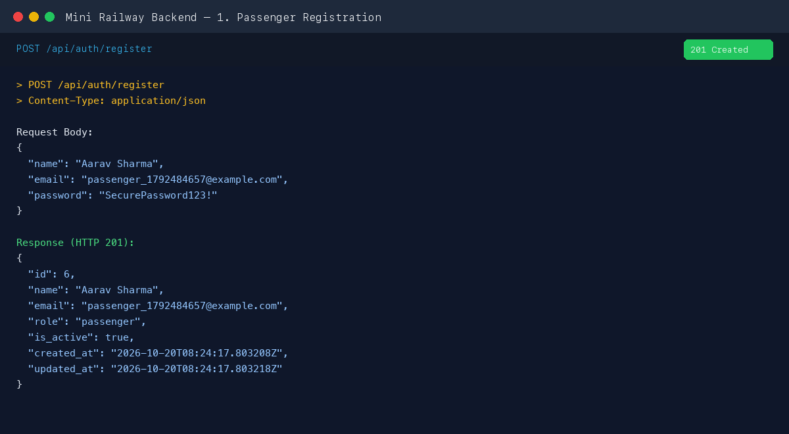

### 2. Passenger Login Success
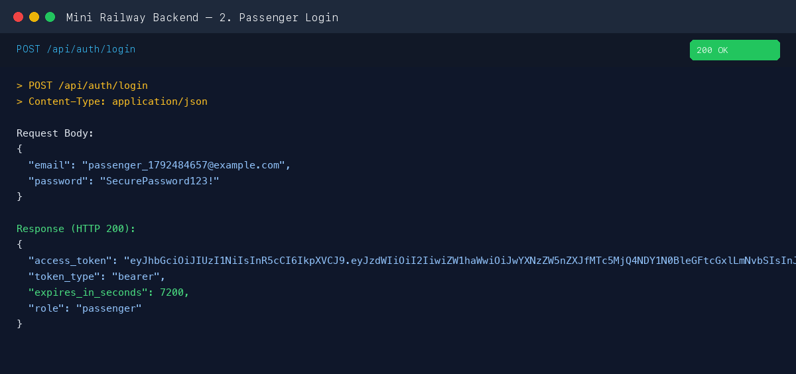

### 3. Failed Login (Invalid Password)
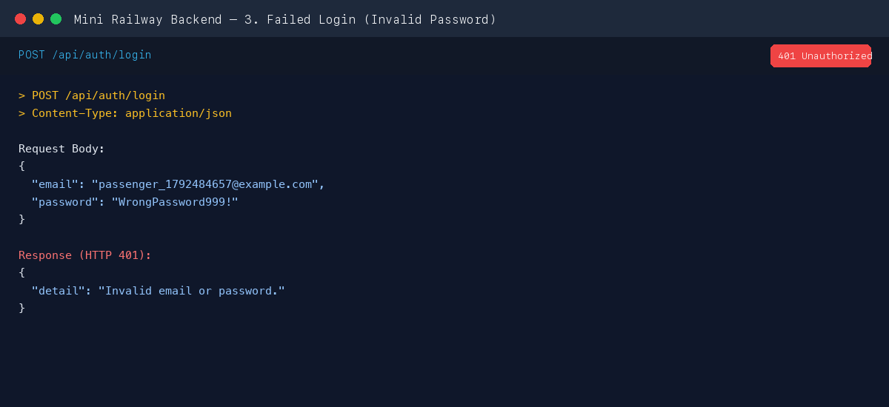

### 4. Unauthorized Access (Passenger accessing Admin API)
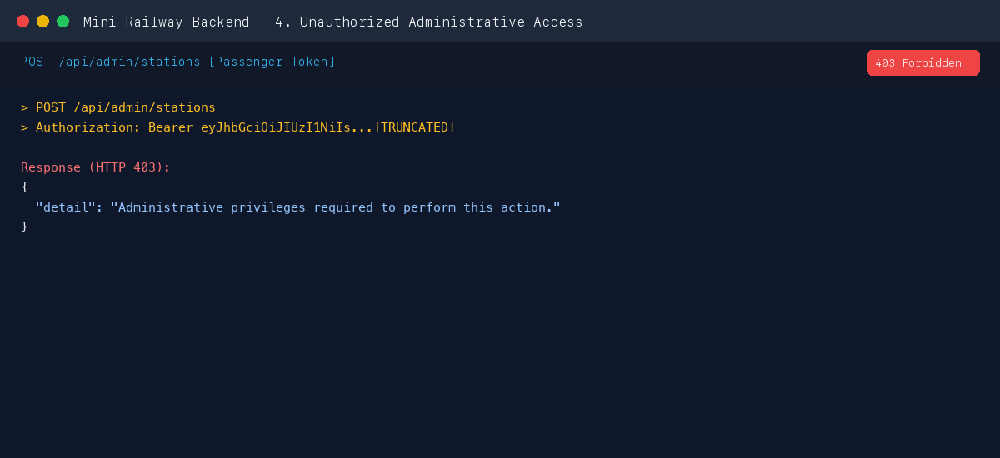

### 5. Forgot Password Request
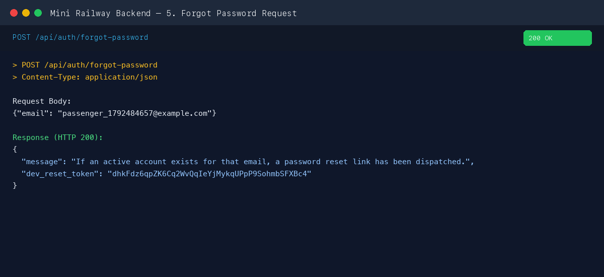

### 6. Password Reset with Single-Use Token
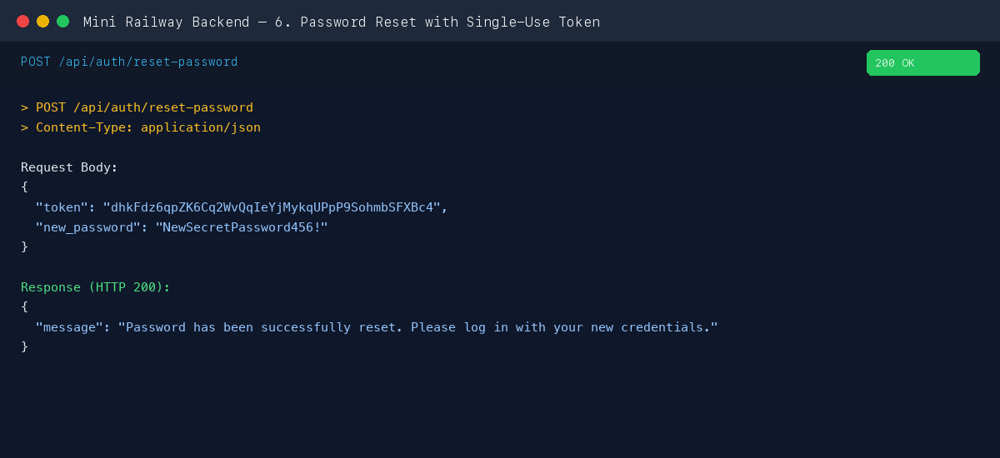

### 7. Administrator Creating Train & Route Stops
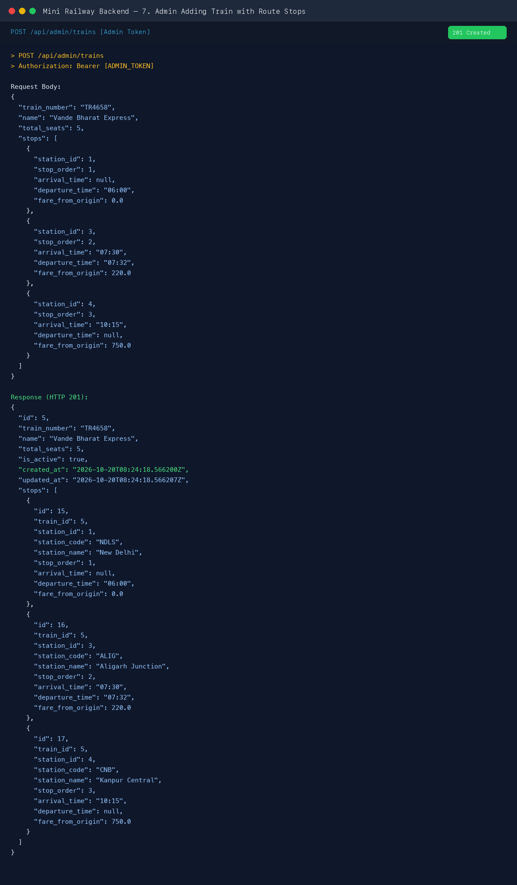

### 8. Train Search between Stations
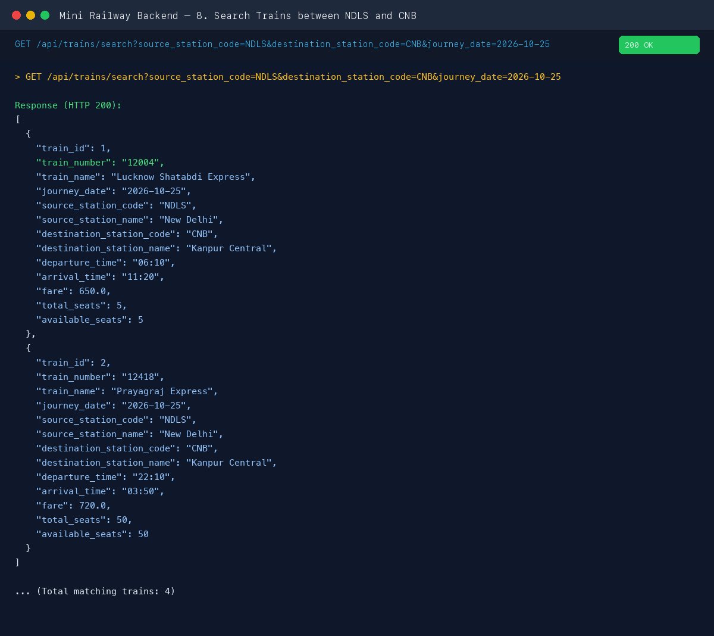

### 9. Checking Real-Time Seat Availability
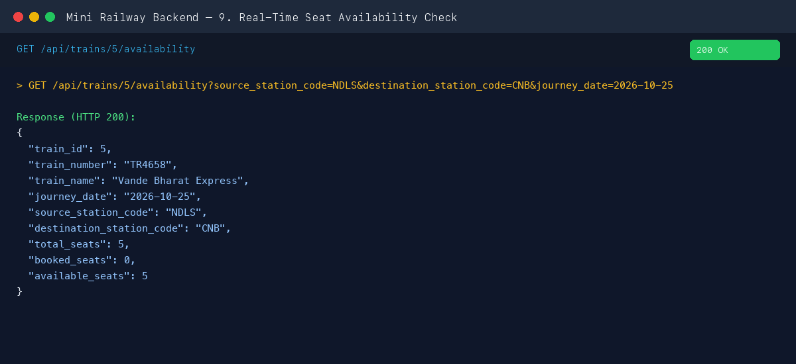

### 10. Booking Confirmation with Unique PNR
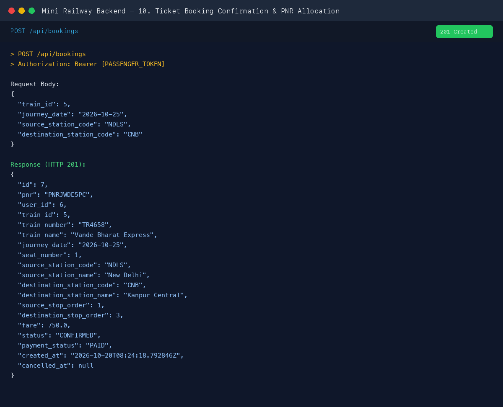

### 11. Passenger Booking History
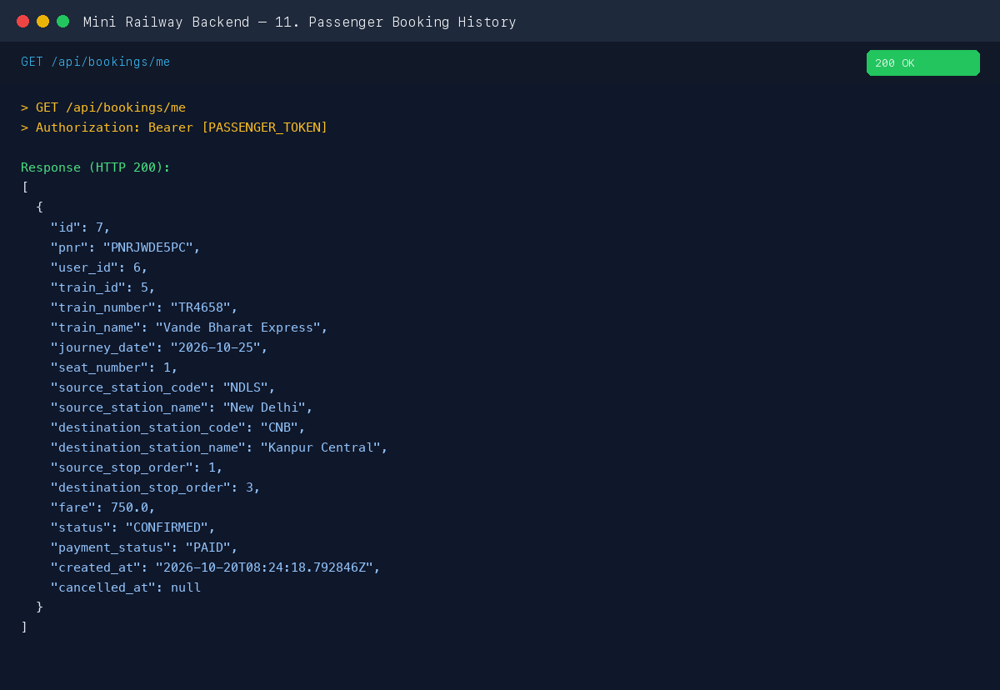

### 12. Ticket Cancellation & Seat Release
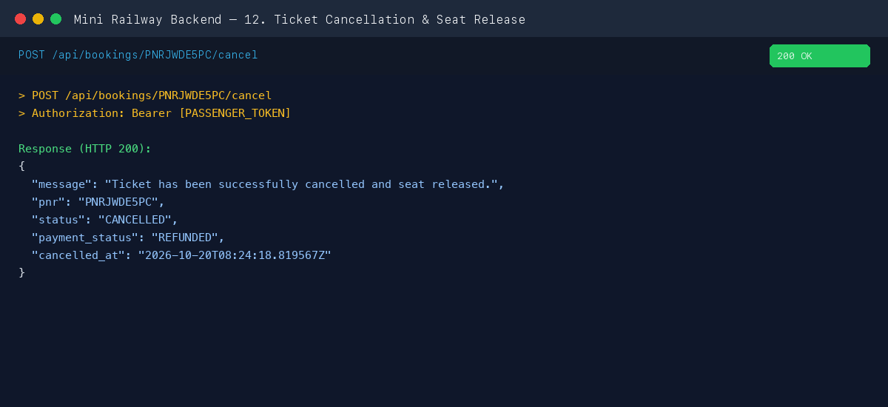

### 13. Full Train Booking Rejection (HTTP 409 Conflict)
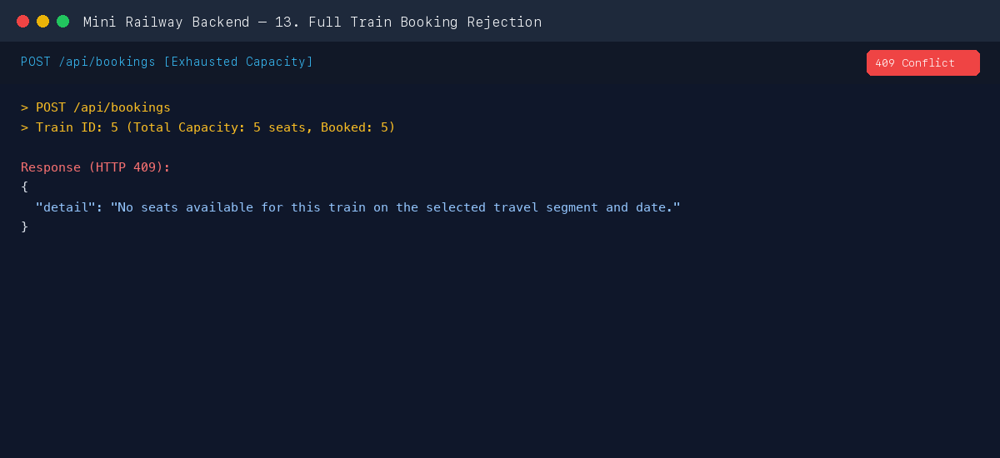

### 14. Concurrency Test Execution (Race Condition Prevention)
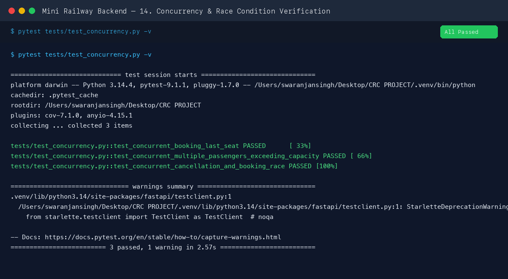

### 15. Complete Test Suite Output with Code Coverage
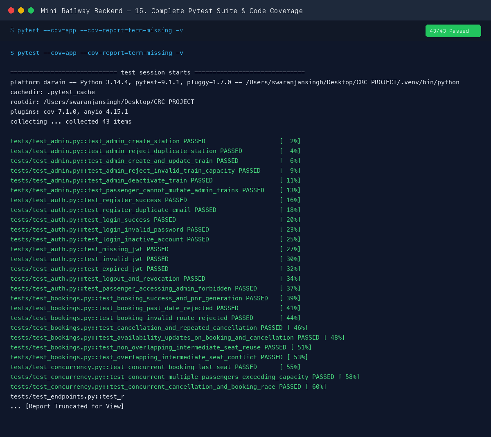

---

## 🔒 Security Considerations

- **Password Storage**: Passwords are never saved in plaintext; only salted bcrypt hashes are stored.
- **Role Isolation**: Public registration strictly assigns `passenger`. The administrator role is never exposed on public registration endpoints.
- **JWT Protection**: Tokens are cryptographically validated against `JWT_SECRET_KEY` and algorithm `HS256`. Client-supplied user claims are never blindly trusted; the active user is loaded fresh from the database.
- **Server-Side Token Revocation**: Logout actively invalidates the token JTI in `token_blocklist`.
- **SQL Injection Immune**: All database queries use SQLModel/SQLAlchemy parameterized queries.
- **Timing Attack Mitigation**: Forgot password returns a generic timing-safe response, preventing user enumeration.
- **Single-Use Reset Tokens**: Reset tokens are stored as SHA-256 hashes, expire in 15 minutes, and are consumed atomically upon use.

---

## ⚠️ Known Limitations & Production Path

1. **SQLite vs. PostgreSQL Concurrency**:
   - SQLite uses a database-level lock for writes. While Write-Ahead Logging (WAL) and `threading.RLock` provide thread safety in single-process ASGI environments, a distributed multi-node production deployment requires a database with row-level locking (such as PostgreSQL with `SELECT ... FOR UPDATE SKIP LOCKED`).
2. **Email Delivery**:
   - In development, the password reset token is simulated and returned in the development JSON response. In production, integrate an SMTP client or transactional email service (e.g., SendGrid, AWS SES) and omit tokens from HTTP responses.
3. **Database Migrations**:
   - The application currently uses `SQLModel.metadata.create_all()` on startup, which creates missing tables but does not alter existing columns. For evolving schemas in production, integrate **Alembic**.

---

## 👨‍🏫 Recommended Live Demo Walkthrough

Follow this step-by-step sequence to demonstrate the application:

1. **Start the Application**:
   ```bash
   uvicorn app.main:app --reload --port 8000
   ```
2. **Open Swagger UI**:
   Navigate to [http://127.0.0.1:8000/docs](http://127.0.0.1:8000/docs).
3. **Health Check**:
   Execute `GET /health` to demonstrate database connectivity and online service status.
4. **Register & Login as Passenger**:
   - Execute `POST /api/auth/register` with name, email, and password.
   - Execute `POST /api/auth/login` to obtain an `access_token`.
   - Click the green **Authorize** button at the top of Swagger UI and paste the token.
5. **Search for Trains**:
   - Execute `GET /api/trains/search` with `source_station_code: NDLS`, `destination_station_code: CNB`, and a future date.
   - Show segment departure/arrival times, fare, and available seats.
6. **Book a Ticket**:
   - Execute `POST /api/bookings` with `train_id: 1`, `source_station_code: NDLS`, `destination_station_code: CNB`.
   - Show the generated unique 10-character PNR (e.g., `PNR4R9JDW0`), assigned seat number (`1`), and status `CONFIRMED`.
7. **Demonstrate Non-Overlapping Seat Reuse**:
   - Log in as another passenger.
   - Book from `CNB` to `LKO` on the same train and date.
   - Show that the second passenger also receives Seat `1` because the journey segments do not overlap!
8. **Demonstrate Full Train Rejection**:
   - Continue booking until the 5 seats on Train 12004 are occupied.
   - Submit another booking and observe the HTTP `409 Conflict` error explaining that capacity is exhausted.
9. **Cancel Ticket & Observe Seat Release**:
   - Execute `POST /api/bookings/{pnr}/cancel`.
   - Show that status updates to `CANCELLED` and payment status updates to `REFUNDED`.
   - Check `GET /api/trains/1/availability` to demonstrate that the seat is immediately available again.
10. **Run the Automated Tests**:
    ```bash
    pytest -v
    ```
    Highlight the 43 passing tests and multithreaded concurrency protection.
